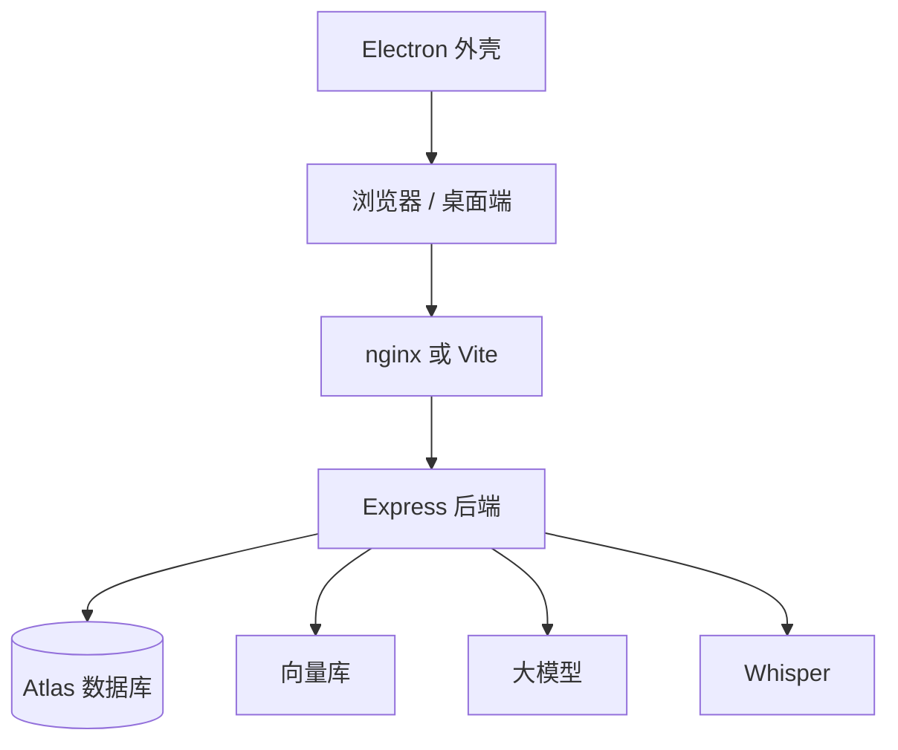
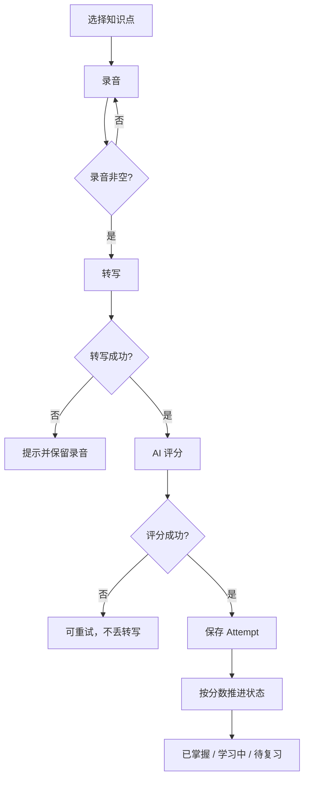
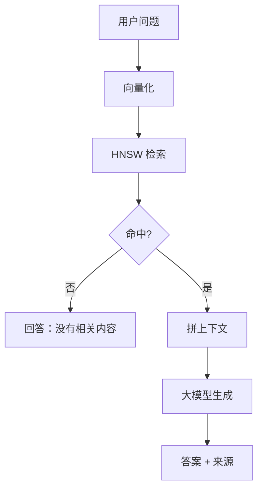
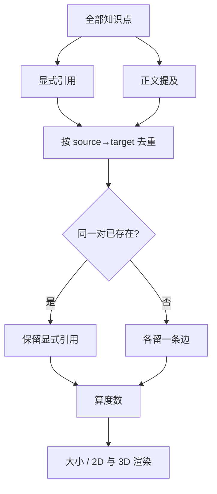
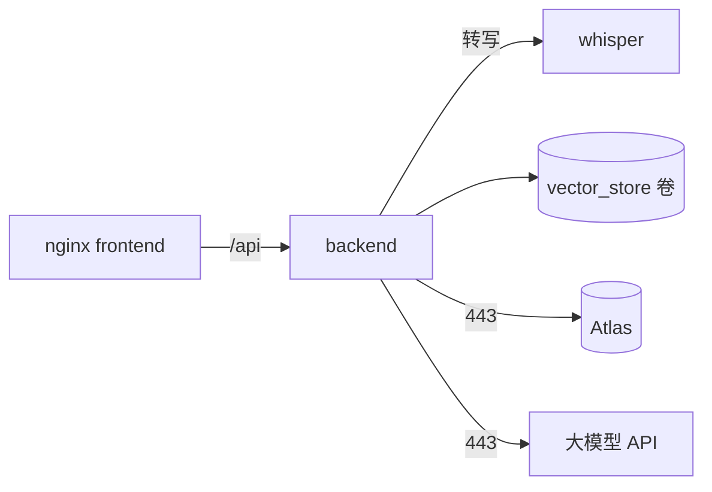

# 实训报告配图 · mermaid 源文件

> 报告里的图 1–5 由下列 mermaid 代码渲染成 PNG 后插入（白底、中性灰）。
> 需要改图时，把对应代码粘到支持 mermaid 的编辑器（或 `mermaid.live`），导出 PNG 覆盖同名文件即可重新生成报告。

## 图 1　系统总体架构

## 图 2　复述闭环（含失败分支）

## 图 3　RAG 检索与生成流程

## 图 4　图谱数据的合并与去重

## 图 5　容器部署拓扑

