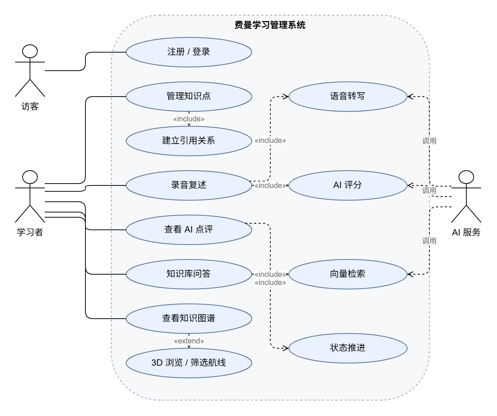
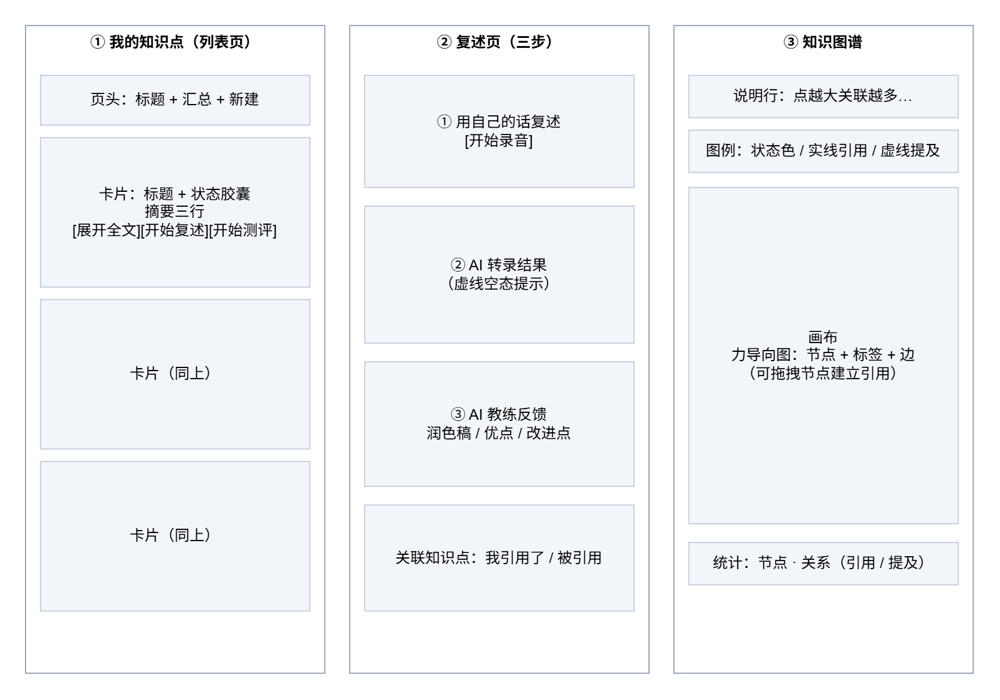
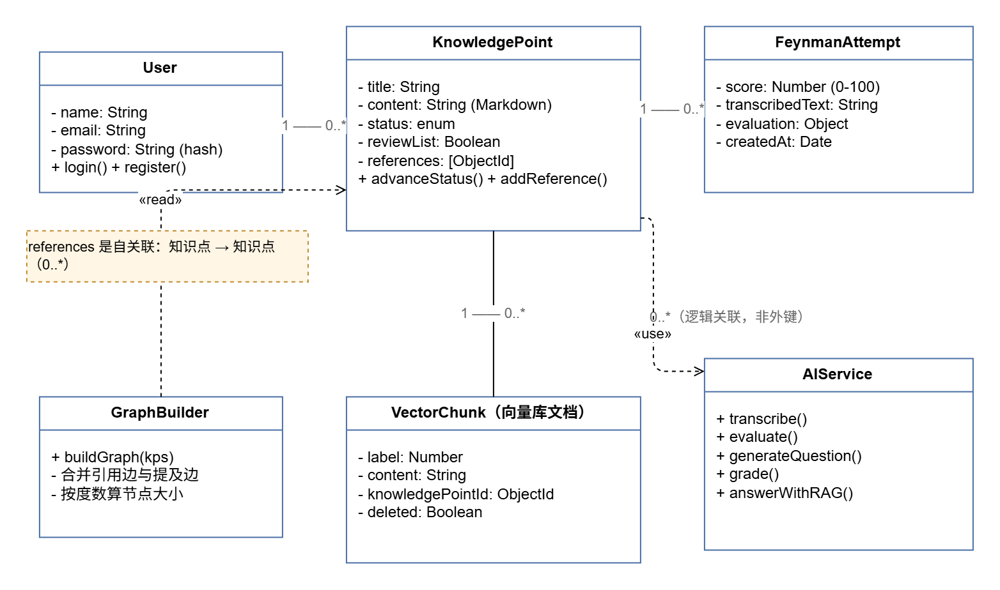
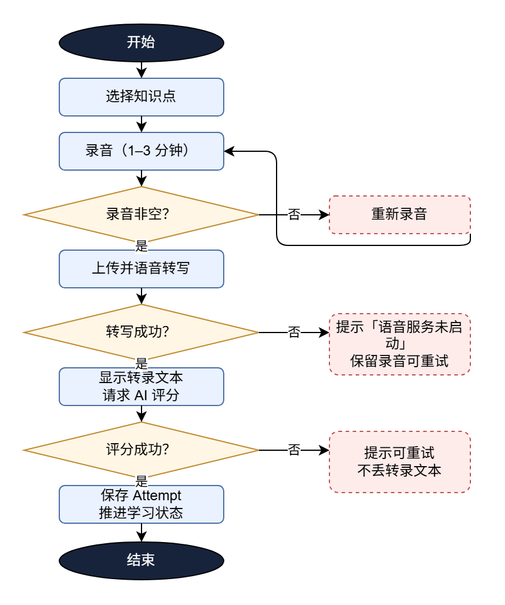
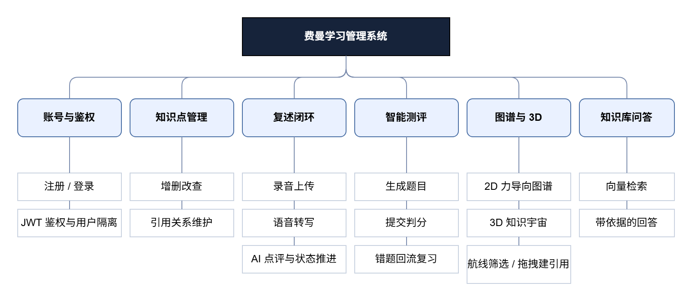
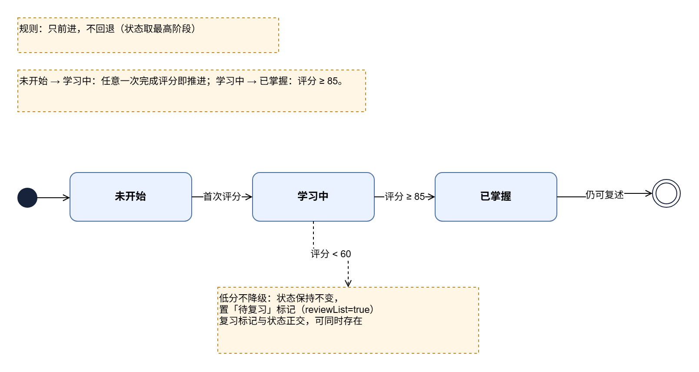

# 费曼学习管理系统 · 选题报告与设计说明

> 课程作业交付物（第 1–5 项文字部分；第 6–10 项图形见 `docs/课程作业/图/`）
>
> 项目目录：`feynman-platform-frontend/`（React 19 + Vite）、`feynman-platform-backend/`（Express + Mongoose + 向量库）、`feynman-platform-whisper-api/`（Whisper 语音转写）

---

## 1. 选定项目

**费曼学习管理系统**：一个把「费曼学习法」变成可执行流程的个人知识管理平台。

用户录入知识点（Markdown / LaTeX / Mermaid），平台提供三条学习路径：

1. **复述**：对着知识点讲一遍 → 语音转文字 → AI 给润色稿、优点与改进点 → 推进学习状态；
2. **测评**：AI 按难度与题型现场出题 → 交卷判分 → 错题自动进入复习列表；
3. **知识库问答**：基于自己录入的知识点做检索增强问答，答案必须附「引用了哪几个知识点」；
4. **可视化**：2D 力导向图谱 + 3D 知识宇宙，把知识点之间的引用关系画出来，支持拖拽建立引用。

技术栈：React 19 / Vite 8 / ECharts / three.js / Express / MongoDB Atlas / hnswlib 向量库 / Whisper / Docker / Electron / PWA。

---

## 2. 为什么选这个项目（实际意义）

### 2.1 从痛点出发

- **「看懂了」不等于「学会了」**：笔记软件只解决存，不解决检验。费曼学习法的核心是「用自己的话讲出来」，但没人听、没人挑错，这件事就很难坚持。
- **AI 时代的新风险**：直接问 AI 会得到看似正确、实则无法核对的答案。学习场景真正需要的是「**先自己讲，再被指出漏洞**」，而不是「直接抄答案」。
- **知识是网状的，笔记是线性的**：单条笔记看不见「闭包依赖作用域链」这类关系，复习时容易断链。

### 2.2 项目能带来的价值

| 对象 | 价值 |
| --- | --- |
| 学生本人 | 把「讲一遍」变成低成本动作（录音即可），并留下可回看的学习轨迹 |
| 教学场景 | 复述评分与错题回流可以作为过程性评价材料，而不是只看期末一次考试 |
| 技术实践 | 一个完整的小型全栈产品：认证、数据建模、向量检索、LLM 编排、可视化、容器化与桌面打包 |

### 2.3 为什么这个题「做得完」

- 边界清楚：单用户、单知识库、无多人协作与权限体系；
- 依赖可控：LLM 走 API、向量库用本地文件、数据库用免费 Atlas；
- 可验证：每个功能都能用真实数据跑通（本仓库已实现并有自测脚本与截图）。

### 2.4 创新点（相对普通笔记 / 背单词 App）

1. **闭环而非工具堆**：录入 → 复述 → 测评 → 状态推进 → 复习，是一条链，不是一个功能列表；
2. **评分有边界**：AI 只依据用户自己的知识库作答，`sources` 为空时明确说「知识库里没有」；
3. **关系可视化**：显式引用（用户手动建）与隐式提及（正文出现标题）两种边，视觉上区分线与色；
4. **同一口径双视图**：2D 与 3D 共用「颜色=状态、大小=关联度、线型=来源」的编码规则。

---

## 3. 同类项目调研

### 3.1 调研方法与说明

- 检索渠道：公开网络（GitHub、PyPI、应用商店、高校项目公示页、技术社区）。
- **关于知网**：本次未能访问校园网内知网（无账号/未在校内网），因此**没有引用 CNKI 文献**。若需补，建议在知网用下列检索式（主题检索）：
  - `费曼学习法 AND 系统设计`
  - `知识图谱 AND 个性化学习系统`
  - `检索增强生成 AND 教育应用`
  - `间隔重复 AND 学习管理`
  并优先按「被引量」与「近三年」筛选。

### 3.2 代表性同类项目

| 项目 | 类型 | 核心机制 | 与本项目的差异 |
| --- | --- | --- | --- |
| Anki / SuperMemo | 记忆卡 | 间隔重复（SM-2 等） | 强在复习调度，弱在「讲」；无 AI 评分 |
| Quizlet / Quizizz | 在线测验 | 题库 + 游戏化测验 | 出题靠人工题库，不基于个人笔记 |
| [Feynman AI（移动应用）](https://play.google.com/store/apps/details?id=com.learning.feynmanai&hl=zh_HK) | 商业 App | 录音讲解 + AI 反馈 + 记忆卡 | 功能接近，但为闭源商业产品、数据在厂商侧 |
| [feynman-ai-tutor-python（GitHub）](https://github.com/kiresakura/feynman-ai-tutor-python) | 开源 Demo | 费曼四步流程 + 讲解回讲 | 单文件原型，无账号体系、无图谱、无出题 |
| [基于费曼学习法的 AI 伴学智能体（北邮项目）](https://win.bupt.edu.cn/program.do?id=11388) | 高校项目 | AI 扮演「零基础学生」多轮追问 | 侧重追问式诊断，非「个人知识库 + 可视化管理」 |
| [open-cognition](https://pypi.org/project/open-cognition/0.2.3/) | 开源工具 | 与 LLM 学习 + 知识图谱 + SM-2 + 费曼技巧 | 偏 CLI/MCP 工具链，无可视化界面与中文教学场景 |
| [DeepTutor（HKUDS）](https://pypi.org/project/deeptutor/1.6.4/) | 开源平台 | Agent 化学习工作区、多引擎 RAG、出题 | 体量大、部署重，超出课程作业范围 |
| [活书 huoshu](https://pypi.org/project/learning-agent/) | 开源工具 | 教材 → 知识图谱 + IRT 掌握度 + SM-2 | 强在「教材导入」，无语音复述环节 |

### 3.3 结论（差异定位）

同类项目大致分三派：**记忆卡派**（Anki）、**测验派**（Quizlet）、**AI 讲解派**（Feynman AI、open-cognition、DeepTutor）。

本项目的位置是第四种组合：**以个人知识库为中心的「讲—评—测—图」一体化**，特点是把三件事放进同一条闭环，并且**可自部署、数据自持**（本地向量库 + 自己的 Atlas 实例 + 可离线 PWA/桌面端）。

---

## 4. 项目能做什么（功能清单）

| 模块 | 功能 | 实现位置 |
| --- | --- | --- |
| 账号 | 注册、登录、JWT 鉴权、当前用户信息 | `routes/users.js`、`middleware/auth.js` |
| 知识点 | 增 / 删 / 改 / 查、按状态筛选、引用关系维护 | `routes/knowledgePoints.js` |
| 内容渲染 | Markdown / LaTeX / Mermaid / 代码高亮 | `components/MarkdownRenderer.jsx` |
| 复述 | 录音上传、语音转写（本地 Whisper 或云端）、AI 点评（润色稿 + 优点 + 改进点）、评分入库 | `routes/audio.js`、`routes/ai.js` |
| 测评 | 按难度/题型生成题目（单选、简答）、交卷判分、错题进复习列表 | `routes/ai.js`、`pages/QuizPage.jsx` |
| 知识库问答 | 检索增强问答（RAG）、返回引用来源、无依据时明确提示 | `routes/ai.js`、`services/prompts/` |
| 状态流转 | 有分 → 学习中；≥85 → 已掌握；只前进不回退；错题 → 待复习 | `utils/knowledgeStatus.js` |
| 图谱 | 引用边 + 提及边合并去重、度数决定节点大小、拖拽建立引用 | `routes/graph.js`、`pages/GraphPage.jsx` |
| 3D 宇宙 | 星球=知识点、航线=关系、飞船=流向、航线筛选 | `pages/KnowledgeUniversePage.jsx` |
| 3D 视界 | Three.js 教学演示（几何/材质/光照/自转） | `pages/ThreeJSPage.jsx` |
| 工程化 | 单元测试、ESLint、Docker 三服务、nginx、Electron、PWA | `docker-compose.yml`、`Dockerfile`、`electron.cjs` |

**非功能要求**：单用户数据隔离（按 `user` 字段）、响应时间 < 2s（不含 LLM）、移动端 ≥ 375px 可用、桌面端 `file://` 可运行、断网可打开已缓存页面。

---

## 5. User Story

### 5.1 角色

- **学习者（主角色）**：个人使用，拥有自己的知识点与学习记录。
- **访客**：只能注册/登录。
- **AI 服务（系统角色）**：提供转写、评分、出题、问答能力。

### 5.2 故事列表（按 MoSCoW 排优先级）

| ID | 角色 | User Story | 验收标准 | 优先级 |
| --- | --- | --- | --- | --- |
| US-01 | 访客 | 我要注册并登录，这样我的知识点只属于我 | 注册成功后可直接登录；未登录访问任何数据接口返回 401 | Must |
| US-02 | 学习者 | 我要用 Markdown 记录一个知识点（含公式与代码），这样内容能表达清楚 | 保存后列表可见；公式/代码块渲染正确；标题与正文不重复显示 | Must |
| US-03 | 学习者 | 我要给知识点建立引用，这样相关知识能连起来 | 编辑页可搜索并勾选其它知识点；保存后图谱出现有向边 | Must |
| US-04 | 学习者 | 我要对着知识点讲一遍并拿到 AI 点评，这样知道哪里没讲清 | 录音上传成功后显示转录文本；点评含润色稿、优点、改进点；记录可在历史里回看 | Must |
| US-05 | 学习者 | 我要被 AI 现场考一考，这样能检验是否真的掌握 | 可选难度与题型；单选题当场判对错；简答题给出采分点对照 | Must |
| US-06 | 学习者 | 我希望答错的知识点自动进入复习列表，这样不会漏掉薄弱点 | 判错后首页该卡片出现「待复习」标记 | Must |
| US-07 | 学习者 | 我希望状态自动推进，这样不用手动维护 | 有评分 → 学习中；≥85 → 已掌握；低分不回退阶段 | Should |
| US-08 | 学习者 | 我要把知识点画成图，这样能看见结构 | 2D 图显示节点与边；节点大小随关联数变化；点击节点可进详情 | Should |
| US-09 | 学习者 | 我要在 3D 里逛自己的知识网络，这样更有整体感 | 星球=知识点；航线区分引用/提及；可筛选只看某一类航线 | Could |
| US-10 | 学习者 | 我要就自己的知识库提问，并看到依据，这样能信任答案 | 答案下方列出引用的知识点并可点击跳转；无依据时提示「知识库里没有」 | Should |
| US-11 | 学习者 | 我要在手机或桌面上都能用 | 375px 宽可用；双击安装包可打开桌面端并看到登录页 | Could |
| US-12 | 学习者 | 我想在拖拽节点时直接建立引用，这样比进编辑页快 | 从节点拖到另一个节点松手后有确认提示，刷新后关系仍在 | Could |

### 5.3 典型故事展开（US-04）

> 作为学习者，我想对着知识点讲一遍，拿到可执行的改进意见。

**前置**：已登录，至少有一个知识点。
**主流程**：进入复述页 → 点「开始录音」→ 讲 1–3 分钟 → 停止 → 自动上传转写 → 显示转录文本 → 点「获取 AI 评价」→ 显示润色稿 / 优点 / 改进点 → 该知识点状态更新。
**异常**：录音为空 → 提示重录；转写服务不可用 → 提示「语音服务未启动」并保留录音；评分超时 → 可重试，不丢转录文本。
**验收**：转录文本非空；点评三项齐全；`FeynmanAttempt` 新增一条记录，含分数与时间。

---

## 6. 用例图

> 可编辑源：`图/费曼学习系统-设计图.drawio` 第 1 页 `01-用例图`。

**参与者**：访客、学习者、AI 服务（外部系统）。

**学习者用例**：注册/登录、管理知识点（增删改查）、建立引用、录音复述、查看 AI 点评、生成测评题、提交答案、查看错题、查看图谱、拖拽建立引用、3D 浏览、知识库问答、查看学习状态。

**包含/扩展关系**：
- 「录音复述」`include`「语音转写」与「AI 评分」；
- 「生成测评题」`extend`「提交答案」（先有题才有答）；
- 「知识库问答」`include`「向量检索」。

---

## 7. 原型图

> 可编辑源：`图/费曼学习系统-设计图.drawio` 第 2 页 `02-原型图`。

按三个关键页面做低保真线框：**列表页（我的知识点）**、**复述页**、**图谱页**。

- 列表页：页头（标题 + 汇总 + 新建）→ 卡片列表（标题 + 状态胶囊 + 摘要三行 + 操作行：展开全文 / 开始复述 / 开始测评 / 编辑 / 删除）；
- 复述页：三步卡片（① 录音 ② 转录结果 ③ AI 教练反馈）+ 关联知识点卡 + 历史记录；
- 图谱页：说明行 + 图例 + 统计 + 画布（节点/边/标签）+ 重置视角。

---

## 8. 类图

> 可编辑源：`图/费曼学习系统-设计图.drawio` 第 3 页 `03-类图`。

核心实体：

- **User**：`name`、`email`、`password`（哈希）、`createdAt`；方法 `register()`、`login()`、`verifyToken()`。
- **KnowledgePoint**：`title`、`content`、`status`（枚举）、`reviewList`（布尔）、`references[]`（自关联 ObjectId）、`user`；方法 `advanceStatus()`、`addReference()`、`removeReference()`。
- **FeynmanAttempt**：`knowledgePoint`、`user`、`score`（0–100）、`transcribedText`、`evaluation`（润色/优点/改进点）、`createdAt`。
- **VectorChunk**（向量库文档，非 Mongo 集合）：`label`、`content`、`knowledgePointId`、`title`、`userId`、`deleted`。
- **AIService**（边界类）：`transcribe()`、`evaluate()`、`generateQuestion()`、`grade()`、`answerWithRAG()`。
- **GraphBuilder**（边界类）：`buildGraph(kps)` → `nodes/links/categories`。

关系：User 1—N KnowledgePoint；KnowledgePoint 1—N FeynmanAttempt；KnowledgePoint N—N KnowledgePoint（`references` 自关联）；KnowledgePoint 1—N VectorChunk（逻辑关联）。

---

## 9. 活动图

> 可编辑源：`图/费曼学习系统-设计图.drawio` 第 4 页 `04-活动图-复述闭环`。

复述闭环：开始 → 选择知识点 → 录音 → 判断录音是否为空（空 → 重录）→ 上传转写 → 判断是否成功（失败 → 提示并保留音频）→ 显示文本 → 请求 AI 评分 → 判断评分是否成功（失败 → 可重试）→ 保存 Attempt → 状态推进（有分→学习中；≥85→已掌握；低分置待复习）→ 结束。

---

## 10. 功能结构图与状态图

> 可编辑源：`图/费曼学习系统-设计图.drawio` 第 5、6 页。

**功能结构图**：三层树 —— 系统 → 6 个模块（账号、知识点、复述、测评、图谱与 3D、知识库问答）→ 各自子功能。

**状态图**：知识点生命周期。

- 状态：`未开始`、`学习中`、`已掌握`；
- 迁移：未开始 →（首次评分）→ 学习中 →（≥85）→ 已掌握；
- 规则：**只前进不回退**（低分不降级）；
- 旁路：`复习标记`（布尔，可置位/清除）与状态正交，可同时为「已掌握 + 待复习」。

---

## 附：图形文件清单

| 文件 | 内容 |
| --- | --- |
| `图/费曼学习系统-设计图.drawio` | 全部 6 张图的可编辑源（drawio 多页：用例/原型/类图/活动/功能结构/状态） |
| `图/01-用例图.png` | 用例图（含 include/extend） |
| `图/02-原型图.png` | 三页低保真原型 |
| `图/03-类图.png` | 类图（6 个类/实体 + 关系） |
| `图/04-活动图.png` | 复述活动图 |
| `图/05-功能结构图.png` | 功能结构树 |
| `图/06-状态图.png` | 知识点状态机 |
