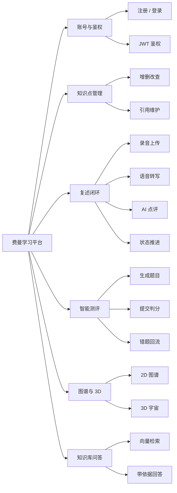
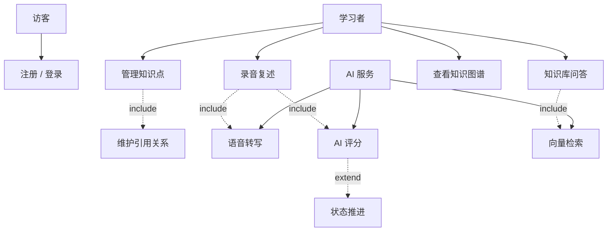
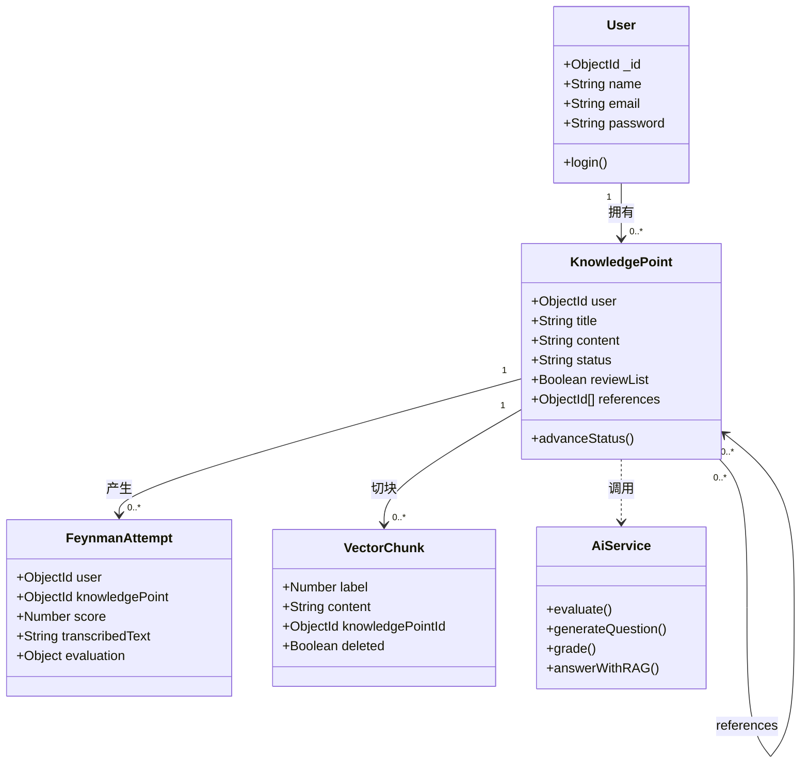
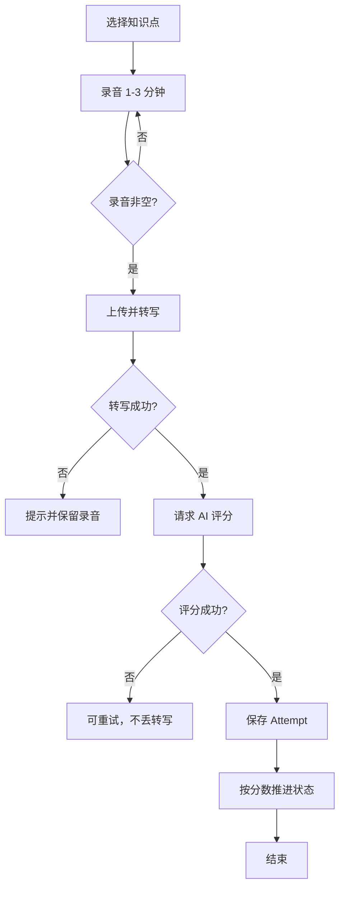
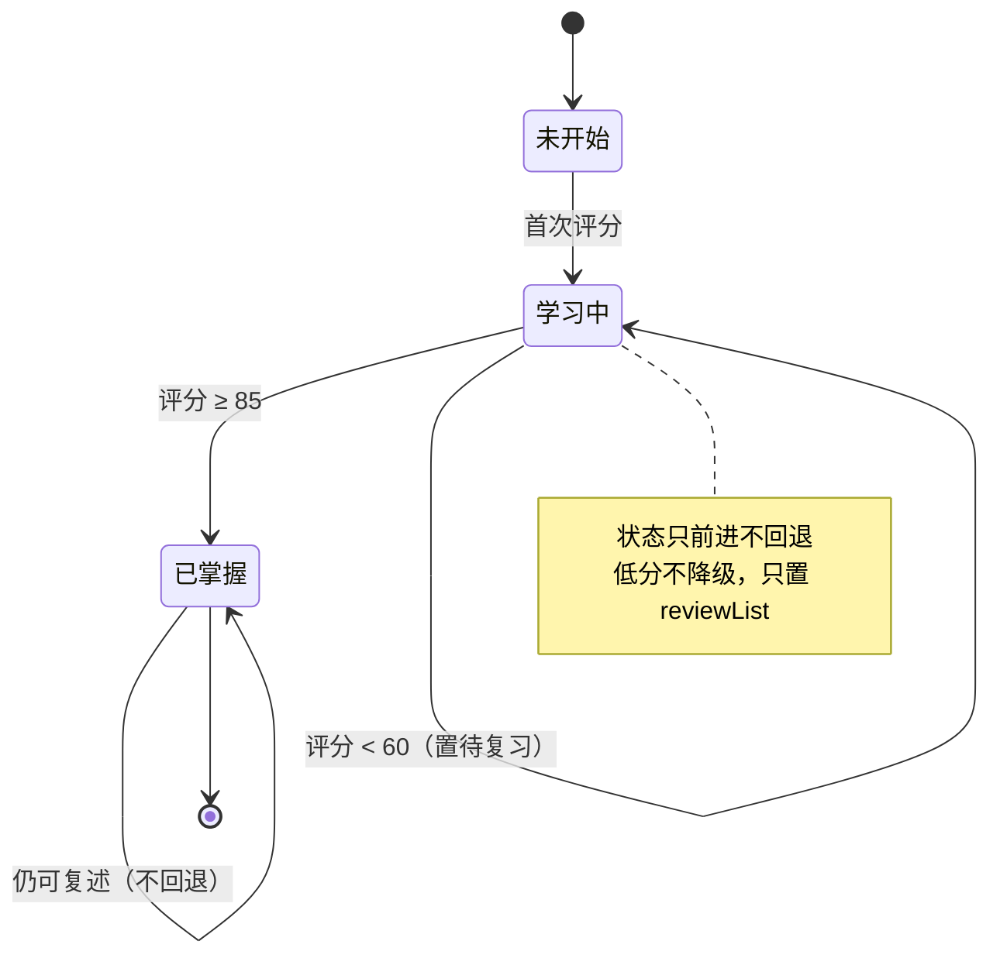
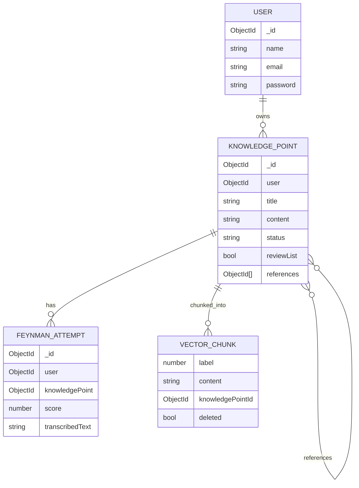

# 实验报告配图 · mermaid 源文件

> 报告中的图 3-1、3-2、5-1、6-1、6-2、7-1 由下列 mermaid 代码渲染（白底、中性灰）后插入 Word。
> 需要改图时，把对应代码粘到支持 mermaid 的编辑器（如 mermaid.live），导出 PNG 替换同名文件后重新生成报告。

## 图 3-1　系统功能框图

## 图 3-2　用例图

## 图 5-1　类图

## 图 6-1　复述闭环流程图

## 图 6-2　知识点状态图

## 图 7-1　ER 图

