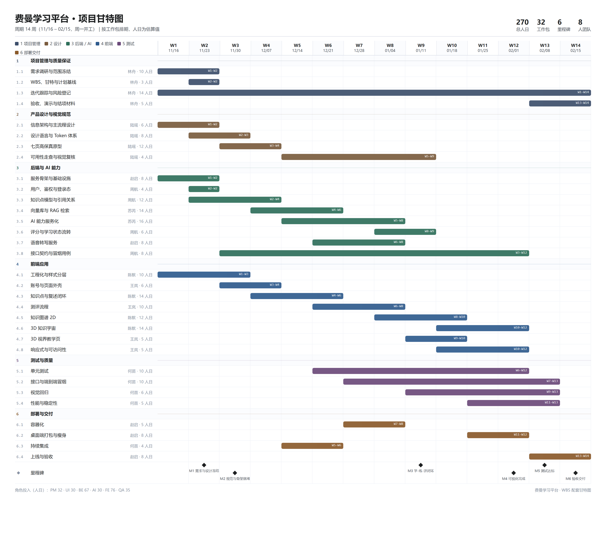

# 费曼学习平台 · WBS 分解与甘特计划

> 版本 v1.0 · 编制日期 2026-11-11 · 计划周期 **14 周**（2026-11-16 周一开工 → 2027-02-19 交付）
> 配套文件：[甘特图（PNG）](甘特图.png) · [甘特图（HTML，可改数据重出图）](甘特图.html)

---

## 1. 项目目标与范围

**目标**：把「知识点 → 语音复述 → AI 评分 → 测评分题 → 知识图谱 / 3D 宇宙」这条学习闭环做成一个可交付、可演示、可继续迭代的产品。

**范围内**（本计划要交付的）：

- 三端产物：Web 前端（React 19 + Vite）、后端 API（Express + MongoDB Atlas）、语音转写服务（whisper）。
- 六类能力：账号与鉴权、知识点与引用关系、复述与 AI 评价、出题与评分、RAG 检索问答、2D 图谱与 3D 可视化。
- 工程交付物：单元测试、接口冒烟、视觉基线、容器化、桌面端安装包、CI、验收材料。

**范围外**（明确不做，避免后期扯皮）：多租户计费、移动原生 App、教师端后台、内容审核系统、多语言。

---

## 2. 团队假设（8 人，虚拟团队）

| 角色 | 姓名 | 职责 | 投入 | 本计划人日 |
| --- | --- | --- | --- | --- |
| 项目经理 / 需求 | 林舟 | 范围、计划、跟踪、验收 | 50% | 32 |
| UI / 体验设计 | 陆瑶 | 信息架构、设计语言、原型、走查 | 50% | 30 |
| 后端负责人 + 运维 | 赵启 | 骨架与安全、语音服务、容器化、发布 | 80% | 37 |
| 后端开发 | 周航 | 知识点/引用、评分流转、接口契约 | 60% | 30 |
| AI 工程 | 苏芮 | RAG、embedding、提示词分层、出题与阅卷 | 60% | 30 |
| 前端负责人（可视化） | 陈默 | 工程与样式体系、图谱、3D 宇宙 | 100% | 50 |
| 前端开发 | 王岚 | 账号外壳、测评、3D 视界、响应式 | 60% | 26 |
| 测试 / 质量 | 何苗 | 单测、接口与端到端、视觉回归、CI | 70% | 35 |
| **合计** | | | | **270 人日** |

> 说明：人日 ≠ 日历日。「100% 投入」按每周 4.5 个可用人日折算，所以 14 周里单人大约能出 60 人日左右，陈默 50 人日是紧的（见 §7 资源风险）。

---

## 3. WBS 编号约定

- 第一层：`1`~`6` 六个阶段（可交付成果层）。
- 第二层：`1.1`、`1.2`…… 工作包，**每个工作包对应一件可验收的产出**，不再往下拆（再拆就是任务清单，放在迭代看板里）。
- 每个工作包都写清：交付物 / 负责人 / 人日 / 前置依赖 / 计划周次。甘特图与下表数据同源。

---

## 4. WBS 分解表

### 1 项目管理与质量保证（8 人日×…共 32 人日）

| 编号 | 工作包 | 交付物 | 负责 | 人日 | 依赖 | 周次 |
| --- | --- | --- | --- | --- | --- | --- |
| 1.1 | 需求调研与范围冻结 | 需求说明、验收标准 | 林舟 | 10 | — | W1–W2 |
| 1.2 | WBS、甘特与计划基线 | WBS 词典、甘特图、里程碑计划 | 林舟 | 3 | 1.1 | W2 |
| 1.3 | 迭代跟踪与风险登记 | 周报 14 份、风险清单 | 林舟 | 14 | 1.2 | W1–W14 |
| 1.4 | 验收、演示与结项材料 | 验收报告、演示脚本 | 林舟 | 5 | 5.4、6.4 | W13–W14 |

### 2 产品设计与视觉规范（30 人日）

| 编号 | 工作包 | 交付物 | 负责 | 人日 | 依赖 | 周次 |
| --- | --- | --- | --- | --- | --- | --- |
| 2.1 | 信息架构与主流程设计 | 站点地图、学-练-评流程图 | 陆瑶 | 6 | 1.1 | W1–W2 |
| 2.2 | 设计语言与 Token 体系 | 色彩/字号/圆角/间距规范、组件清单 | 陆瑶 | 8 | 2.1 | W2–W3 |
| 2.3 | 七页高保真原型 | 登录、列表、复述、测评、图谱、3D 宇宙、3D 视界 | 陆瑶 | 12 | 2.2 | W3–W4 |
| 2.4 | 可用性走查与视觉复核 | 走查问题单、修正后的基线截图 | 陆瑶 | 4 | 2.3、4.3 | W5–W9 |

### 3 后端与 AI 能力（97 人日，含 AI 30）

| 编号 | 工作包 | 交付物 | 负责 | 人日 | 依赖 | 周次 |
| --- | --- | --- | --- | --- | --- | --- |
| 3.1 | 服务骨架与基础设施 | Express 脚手架、Mongo 连接、错误中间件、CORS/安全中间件 | 赵启 | 8 | 1.1 | W1–W2 |
| 3.2 | 用户、鉴权与登录态 | 注册/登录/JWT、401 统一处理 | 周航 | 4 | 3.1 | W2 |
| 3.3 | 知识点模型与引用关系 | CRUD、references 校验、级联清理 | 周航 | 12 | 3.1 | W2–W4 |
| 3.4 | 向量库与 RAG 检索 | 分块、embedding 分批、HNSW 索引、墓碑与压缩、同步脚本 | 苏芮 | 14 | 3.3 | W4–W6 |
| 3.5 | AI 能力服务化 | prompts 分层、出题、阅卷、复述评价、RAG 问答 | 苏芮 | 16 | 3.4 | W5–W8 |
| 3.6 | 评分与学习状态流转 | 评分阈值、状态只前进、错题回流 | 周航 | 6 | 3.5 | W8–W9 |
| 3.7 | 语音转写服务 | whisper 服务、并发临时文件隔离、容器化 | 赵启 | 8 | 3.1 | W6–W8 |
| 3.8 | 接口契约与冒烟用例 | api-tests.http、接口冒烟脚本 | 周航 | 8 | 3.2、3.3 | W3–W12 |

### 4 前端应用（76 人日）

| 编号 | 工作包 | 交付物 | 负责 | 人日 | 依赖 | 周次 |
| --- | --- | --- | --- | --- | --- | --- |
| 4.1 | 工程化与样式分层 | Vite 配置、路由、CSS 分层（foundation/components/pages） | 陈默 | 10 | 1.1 | W1–W3 |
| 4.2 | 账号与页面外壳 | 登录、注册、导航、404、错误边界 | 王岚 | 6 | 4.1、2.3 | W3–W4 |
| 4.3 | 知识点与复述闭环 | 列表、表单、录音、转录、AI 评价 | 陈默 | 14 | 4.2、3.3 | W4–W6 |
| 4.4 | 测评流程 | 出题、答题、判分、错题提醒 | 王岚 | 10 | 4.3、3.5 | W6–W8 |
| 4.5 | 知识图谱 2D | 力导向渲染、拖拽建引用、标签防重叠 | 陈默 | 12 | 4.4、3.6 | W8–W10 |
| 4.6 | 3D 知识宇宙 | 星球贴图、航线与飞船、航线筛选 | 陈默 | 14 | 4.5 | W10–W12 |
| 4.7 | 3D 视界教学页 | 几何体/材质/光照演示、读数面板 | 王岚 | 5 | 4.2 | W9–W10 |
| 4.8 | 响应式与可访问性 | 窄屏适配、焦点环、键盘可达 | 王岚 | 5 | 4.6 | W10–W12 |

### 5 测试与质量（35 人日）

| 编号 | 工作包 | 交付物 | 负责 | 人日 | 依赖 | 周次 |
| --- | --- | --- | --- | --- | --- | --- |
| 5.1 | 单元测试 | 纯函数用例（markdownText、graphService、knowledgePointService） | 何苗 | 10 | 4.1、3.3 | W6–W12 |
| 5.2 | 接口与端到端冒烟 | 接口冒烟脚本、关键路径用例 | 何苗 | 10 | 3.8、4.4 | W7–W13 |
| 5.3 | 视觉回归 | 基线截图、计算样式核对清单 | 何苗 | 6 | 2.4、4.6 | W9–W13 |
| 5.4 | 性能与稳定性 | 首屏拆包、3D 帧率、长列表性能 | 何苗 | 5 | 4.6 | W11–W13 |

### 6 部署与交付（25 人日）

| 编号 | 工作包 | 交付物 | 负责 | 人日 | 依赖 | 周次 |
| --- | --- | --- | --- | --- | --- | --- |
| 6.1 | 容器化 | 三个 Dockerfile、compose 编排 | 赵启 | 5 | 3.7 | W7–W8 |
| 6.2 | 桌面端打包与瘦身 | Electron 安装包、产物体积优化 | 赵启 | 8 | 4.6 | W11–W12 |
| 6.3 | 持续集成 | GitHub Actions：lint / test / build | 何苗 | 4 | 4.1 | W5–W6 |
| 6.4 | 上线与验收 | 部署记录、验收演示、结项 | 赵启 | 8 | 5.2、5.3、6.1、6.2 | W13–W14 |

**合计：32 个工作包 / 270 人日。** 按角色：PM 32 · UI 30 · BE 67 · AI 30 · FE 76 · QA 35。

---

## 5. 甘特图

> 图为 14 周计划的横道图：左侧为 WBS 编号与工作包（含负责人与人日），右侧按周排布，颜色区分六个阶段，底部菱形为里程碑。
> 需要调整排期时改 `甘特图.html` 内联脚本里的 `tasks` 数组后重新打开即可（或告诉我改哪几条，我重出图）。

### 里程碑

| 里程碑 | 时点 | 判定标准（可验收） |
| --- | --- | --- |
| M1 需求与设计冻结 | W2 末 | 需求说明与验收标准评审通过，范围不再新增 |
| M2 规范与骨架就绪 | W3 末 | 设计 Token 定稿；后端能被前端联调（登录 + 知识点 CRUD 通） |
| M3 学-练-评闭环打通 | W9 末 | 新建知识点 → 复述 → AI 评价 → 出题 → 判分 → 错题入复习，一条链路走通 |
| M4 可视化完成 | W12 末 | 2D 图谱可拖拽建引用；3D 宇宙可看航线/飞船并支持筛选 |
| M5 测试达标 | W13 末 | 单测全绿、接口冒烟全过、视觉基线无未解释差异、构建无错误 |
| M6 验收交付 | W14 末 | 部署可访问、安装包可装、验收材料齐 |

---

## 6. 关键路径与依赖说明

**关键路径**：
`1.1 → 2.1 → 2.2 → 2.3 → 4.2 → 4.3 → 4.4 → 4.5 → 4.6 → 5.3 → 6.4`（约 13 周，只有 1 周浮动）。

- 这条路上任何一环晚 1 周，交付就晚 1 周，所以 **4.5 / 4.6 的两个可视化工作包必须按周盯**。
- 后端并行路径 `3.1 → 3.3 → 3.4 → 3.5 → 3.6` 与前端 `4.3 / 4.4` 有 2 周缓冲：前端可以先吃 mock 接口开发，不必等后端完全就绪（这也是把 3.8 接口契约拉到 W3 开工的原因）。
- `5.3 视觉回归` 依赖 `4.6`，是全片最后一个测试包，它压线则 `6.4` 必压线——**这是第 13 周最大的风险点**。

---

## 7. 资源与风险

| # | 风险 | 影响 | 应对 |
| --- | --- | --- | --- |
| 1 | 陈默一人扛 50 人日（前端 76 人日里占 2/3），且集中在 W8–W12 的可视化 | 关键路径断档 | 把 4.8（响应式）与 4.7（3D 视界）交给王岚；W10 之后陈默不再接新包；必要时把 4.6 的「飞船/筛选」降级为可选 |
| 2 | LLM 输出不稳定（出题/阅卷返回非法 JSON） | 联调反复、演示翻车 | 接口层做 JSON 容错与预置桩；演示环境用预置响应，不依赖实时模型 |
| 3 | 向量库是全局单库，多人共用时互相拖累 | 检索质量与成本 | 本计划内加「按用户命名空间」的预留改造（3.4 顺带），不做分库 |
| 4 | 语音转写服务未真机验证（模型 + ffmpeg） | W8 验收时可能才发现装不起来 | W6 就把 3.7 的容器化提前到与开发并行，先用 CPU 小模型跑通链路 |
| 5 | 3D 页面在集显机器掉帧 | 演示观感 | 5.4 设硬指标（中端集显 ≥ 40fps），不达标则降级 bloom 与星点数 |
| 6 | 桌面端包体（Electron + mermaid/echarts/three）偏大 | 分发成本 | 6.2 里做依赖裁剪与压缩，目标 < 100 MB |
| 7 | Atlas 出口 IP 白名单频繁变化导致联调中断 | 团队进度 | 固定一台开发机做代理出口；本地 docker 起一个 Mongo 作离线备用 |

---

## 8. 计划假设与后续

- 每周 5 个工作日、无节假日占用的理想排期；节假日顺延时整条链后移。
- 人日是「净开发」估算，不含会议与返工；实际按 1.15 系数挂进度缓冲（已包含在 1.3 与各包余量里）。
- 本 WBS 只到工作包层。每个包在进入迭代时再拆成 2–5 个任务、挂到看板上，并按周更新燃尽。
- 若要把计划落到工具里（Excel / 飞书多维表格 / Jira 导入格式），说一声，我按同一份数据导出。
