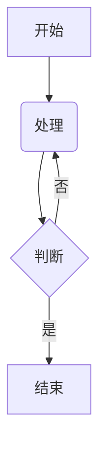

# 费曼学习平台 · 前端（feynman-platform-frontend）

基于 **React + Vite** 构建的费曼学习平台前端应用，覆盖课程第四～十五次课内容：前端骨架搭建 → 前后端联调 → 知识点模块与富文本渲染 → 录音复述与 AI 反馈 → AI 测评与知识库问答 → 知识图谱与 3D 可视化 → 跨平台打包（Electron / PWA）。

## 技术栈

| 分类 | 技术 | 用途 |
|---|---|---|
| 框架 | React 19 | 组件化 UI、数据驱动视图 |
| 构建工具 | Vite | 开发服务器、打包构建 |
| 路由 | react-router-dom | 客户端路由（SPA 页面跳转） |
| 网络请求 | axios | 封装 apiClient，统一携带 token |
| 状态管理 | React Context API | 全局登录状态（token） |
| Markdown 编辑 | @uiw/react-md-editor | 知识点内容编辑 |
| Markdown 渲染 | react-markdown + remark-gfm | 安全渲染 Markdown（含表格等扩展语法） |
| 数学公式 | remark-math + rehype-katex | 渲染 LaTeX 公式（如 $E=mc^2$） |
| 图表 | mermaid | 渲染流程图等（由 ```mermaid 代码块触发） |
| 安全 | DOMPurify | 对 Mermaid 生成的 SVG 消毒，防 XSS |
| 录音 | Web Audio API（AudioContext） | 16kHz 单声道录音，封装为 WAV 上传百度 ASR |
| 知识图谱 | echarts | 2D 力导向图（原生引入，避免 React 19 peer 冲突） |
| 3D 入门 | three + OrbitControls | 旋转立方体与轨道控制器（3D 视界页） |
| 3D 知识宇宙 | d3-force-3d + three | 知识节点力导向布局 + Raycaster 拾取交互 |
| PWA | vite-plugin-pwa | 离线缓存、可安装应用（manifest + Service Worker） |
| 桌面端 | Electron + electron-builder | 打包为 Windows / macOS 桌面应用 |

## 目录结构

```
feynman-platform-frontend/
├── index.html                    # 入口 HTML（React 挂载到 #root）
├── vite.config.js                # Vite 配置（React 插件、端口 5173、PWA）
├── electron.cjs                  # Electron 主进程（原生菜单、加载 dist 产物）
├── package.json                  # 项目依赖与脚本（含 electron 打包配置）
├── public/
│   ├── pwa-192x192.png           # PWA 图标（小）
│   └── pwa-512x512.png           # PWA 图标（大）
└── src/
    ├── main.jsx                  # 入口：BrowserRouter + AuthProvider + App
    ├── App.jsx                   # 路由配置（公共路由 + 受保护路由）
    ├── index.css                 # 全局基础样式（含 AI/可视化页面样式）
    ├── api/
    │   └── axios.js              # axios 实例：baseURL + token 请求拦截器
    ├── context/
    │   └── AuthContext.jsx       # 全局认证上下文（token / login / logout）
    ├── hooks/
    │   └── useAudioRecorder.js   # 录音 hook：16kHz PCM 采集 + WAV 编码
    ├── components/
    │   ├── Layout.jsx            # 通用布局（导航栏 + Outlet）
    │   ├── ProtectedRoute.jsx    # 路由守卫（未登录 → /login）
    │   ├── MarkdownRenderer.jsx  # Markdown/GFM/LaTeX/Mermaid 统一渲染
    │   └── MermaidRenderer.jsx   # Mermaid 图表渲染（SVG + DOMPurify 消毒）
    └── pages/
        ├── LoginPage.jsx         # 登录页（对接 POST /api/users/login）
        ├── RegisterPage.jsx      # 注册页（对接 POST /api/users/register）
        ├── DashboardPage.jsx     # 主页：知识点列表 + 各功能入口
        ├── KnowledgePointFormPage.jsx  # 新建/编辑知识点（Markdown 编辑器）
        ├── FeynmanRecordPage.jsx # 07/08课：录音 → 转录 → AI 润色评价 → 保存
        ├── QuizPage.jsx          # 09课：AI 出题与智能测评（单选/简答）
        ├── AgentPage.jsx         # 11课：RAG 私有知识库问答助手
        ├── GraphPage.jsx         # 12课：知识图谱（ECharts 力导向图）
        ├── ThreeJSPage.jsx       # 13课：Three.js 3D 入门（旋转立方体）
        └── KnowledgeUniversePage.jsx # 14课：3D 知识宇宙（d3-force-3d）
```

## 快速开始

前置条件：后端 `feynman-platform-backend` 已启动（默认 `http://localhost:3000`）。

```bash
# 1. 安装依赖
npm install

# 2. 启动开发服务器（默认 http://localhost:5173）
npm run dev

# 3. 生产构建（输出到 dist/，含 PWA Service Worker）
npm run build
```

跨平台相关命令（15课）：

```bash
# 以桌面应用方式运行（先 build 再启动 Electron）
npm run electron:dev      # 同时启动 Vite 与 Electron（开发调试）
npm run electron:build    # 使用 electron-builder 打包为安装包（输出到 release/）

# PWA 测试：构建后用静态服务器托管 dist/（Service Worker 需要 http(s)）
npx serve dist
```

## 页面路由

| 路径 | 页面 | 是否需要登录 |
|---|---|---|
| `/login` | 登录 | 否 |
| `/register` | 注册 | 否 |
| `/` | 知识点列表（主页，含各功能入口） | 是（路由守卫保护） |
| `/kp/new` | 新建知识点 | 是 |
| `/kp/edit/:id` | 编辑知识点 | 是 |
| `/feynman/:id` | 费曼复述（录音 → 转录 → AI 评价 → 历史记录） | 是 |
| `/quiz/:id` | AI 智能测评（出题 / 答题 / 评分 / 错题复习） | 是 |
| `/agent` | AI 知识库问答助手（RAG） | 是 |
| `/graph` | 知识图谱（2D 力导向图） | 是 |
| `/3d-world` | 3D 视界（Three.js 旋转立方体入门） | 是 |
| `/knowledge-universe` | 3D 知识宇宙（d3-force-3d + 点击交互） | 是 |

## 与后端的对接约定

- **基础路径**：`http://localhost:3000/api`（见 `src/api/axios.js`，后端已开启 CORS）
- **认证方式**：登录/注册成功后后端返回 `{ token }`，由 `AuthContext` 存入 `localStorage`；axios 请求拦截器自动为每个请求附加 `x-auth-token` 请求头
- **注册字段**：`name` / `email` / `password`（与后端 User 模型字段一致）
- **刷新保持登录**：token 从 `localStorage` 初始化，刷新页面不掉线
- **退出登录**：清除全局 token（含 `localStorage`）并跳转登录页
- **录音上传**：`useAudioRecorder` 输出 16kHz 单声道 WAV Blob，以 multipart 表单字段名 `audio` 上传到 `/audio/transcribe`
- **AI 反馈保存**：复述记录通过 `POST /attempts` 保存（`transcribedText` + `aiFeedback` 嵌套对象）

## 富文本渲染能力

在知识点内容中可直接书写：

````markdown
# Markdown 标题、**加粗**、表格等（GFM 扩展语法）

行内公式：$E=mc^2$

块级公式：
$$
\int_a^b f(x) dx = F(b) - F(a)
$$


````

渲染安全性说明：react-markdown 默认不渲染原始 HTML 标签（`<script>` 等会被过滤）；Mermaid 生成的 SVG 额外经 DOMPurify 消毒，双重保险防 XSS。

## 常见问题

1. **页面能打开但接口报错**：检查后端是否已启动、`.env` 的数据库连接是否正确。
2. **登录后刷新被踢回登录页**：检查浏览器是否禁用了 `localStorage`。
3. **跨域报错（CORS）**：确认后端 `index.js` 中已启用 `app.use(cors())` 并重启后端。
4. **录音后转写失败**：确认已授权麦克风权限、后端 `.env` 已配置 `QIANFAN_API_KEY`（语音识别复用千帆 Key），且该应用已开通百度「短语音识别」能力（或改用本地 Whisper，见 `../feynman-platform-whisper-api`）。
5. **AI 功能返回 502**：`.env` 中未配置任何 LLM 的 API Key（DeepSeek / 千帆 / OpenAI 至少一个），或 Key 已失效。
6. **构建体积警告（chunk > 500kB）**：three.js + echarts + d3-force-3d 体积较大，属正常现象，不影响运行；如需优化可对可视化页面做动态 `import()` 懒加载。
7. **Electron 安装慢/失败**：设置镜像后重装：`$env:ELECTRON_MIRROR='https://npmmirror.com/mirrors/electron/'; npm install`。
